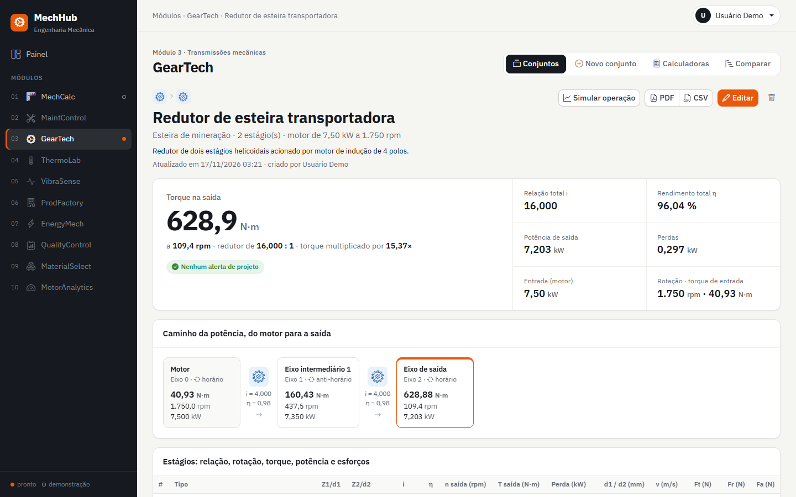
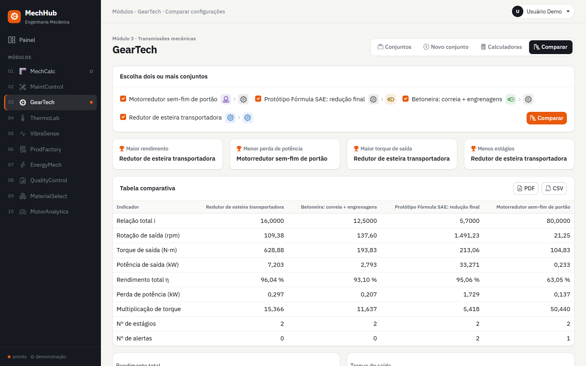
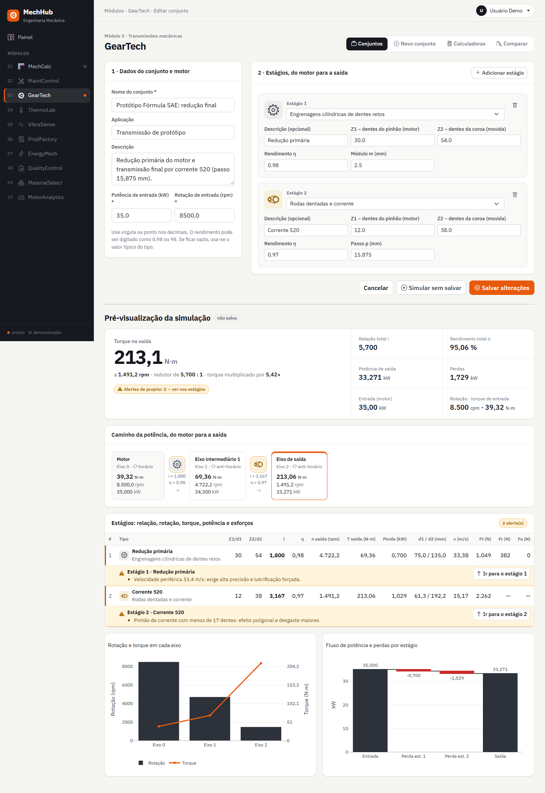
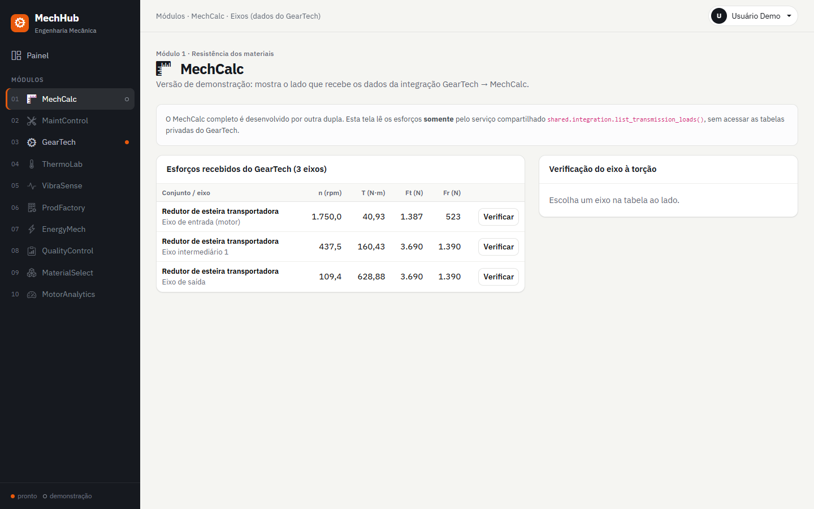

# MechHub · Módulo 3 — GearTech

**Análise de transmissões mecânicas** dentro da plataforma SaaS integrada **MechHub** (Trabalho Final de Linguagem de Programação — Engenharia Mecânica).

- **Dupla 2:** Lucas e Emerson
- **Módulo:** 3 — GearTech (transmissões mecânicas)
- **Integração obrigatória:** GearTech → MechCalc (esforços e parâmetros de transmissão para análises mecânicas)
- **Tecnologias:** Python 3 · Flask · SQLite + SQLAlchemy · Bootstrap · Plotly · NumPy · Pandas · ReportLab · Pytest · Git



## Como executar

Pré-requisito: Python 3.11 ou mais novo.

```bash
python -m venv .venv
.venv\Scripts\activate          # Windows  (Linux/macOS: source .venv/bin/activate)
pip install -r requirements.txt
python run.py
```

Abra **http://127.0.0.1:5000** e entre com a conta de demonstração:

| E-mail | Senha |
|---|---|
| `demo@mechhub.local` | `mechhub123` |

Na primeira execução o banco `instance/mechhub.db` é criado com uma organização fictícia e quatro conjuntos de exemplo (redutor de esteira, betoneira, Fórmula SAE e motorredutor sem-fim). Apague esse arquivo para recomeçar do zero.

### Acesso rápido no Windows (um clique)

```bash
.venv\Scripts\python.exe criar_atalho.py
```

Cria o ícone **MechHub** na Área de Trabalho e no Menu Iniciar (dá para procurar "MechHub" no Iniciar). O atalho liga o servidor em segundo plano, sem janela preta, e abre o navegador. Se o servidor já estiver ligado, só abre o navegador.

- `abrir_mechhub.pyw`: o que o atalho executa.
- `parar_mechhub.pyw`: desliga o servidor (dois cliques).
- `iniciar.bat`: alternativa com janela; na primeira vez cria o ambiente e o atalho.

### Testes

```bash
python -m pytest
```

72 testes automatizados: fórmulas, banco de dados, telas, tratamento de erros e integração.

## As 8 funcionalidades do GearTech

| # | Funcionalidade (enunciado) | O que o sistema faz |
|---|---|---|
| 1 | Cadastrar conjuntos de transmissão | Cadastro, edição e exclusão de conjuntos com até 10 estágios: engrenagens retas, helicoidais, polias e correia, corrente e sem-fim. Dados por organização. |
| 2 | Calcular relações de transmissão | i = Z₂/Z₁ ou d₂/d₁ por estágio e i_total = Π iₖ; indica se é redutor ou multiplicador. |
| 3 | Calcular rotações | n₂ = n₁/i em cada eixo, velocidade angular ω e sentido de rotação. |
| 4 | Calcular torque | T = P/ω e T₂ = T₁·i·η em cada eixo; forças no dente Ft, Fr e Fa. |
| 5 | Calcular potência | P₂ = P₁·η, perdas por estágio e rendimento total. |
| 6 | Simular transmissões com múltiplos estágios | Simulação estágio a estágio (com pré-visualização sem salvar) e simulação de operação variando rotação ou potência do motor. |
| 7 | Comparar configurações | Tabela comparativa, destaque do melhor por critério e gráficos lado a lado. |
| 8 | Gerar gráficos e relatórios | Gráficos interativos (Plotly), relatório PDF (ReportLab) e exportação CSV (Pandas). |

Além disso: **calculadoras rápidas** (relação, rotação, torque e potência) com histórico salvo, **alertas de projeto** (interferência com Z₁ < 17, relação alta demais, velocidade excessiva, sem-fim autotravante) e **histórico de versões** de cada conjunto.

| Comparação de configurações | Simulação sem salvar |
|---|---|
|  |  |

## Design da interface

Paleta **"Oficina"**, escolhida para um sistema de engenharia: neutros na estrutura e **um único acento** (laranja segurança, a cor de alerta de máquinas industriais) reservado para a ação principal e o número mais importante de cada tela. A proporção segue a regra 60-30-10.

| Papel | Cor | Uso |
|---|---|---|
| Grafite | `#16191F` | menu lateral, títulos, texto |
| Grafite claro | `#2C313A` | 1ª série dos gráficos, botões secundários ativos |
| Cinza aço | `#5F6773` | textos de apoio, unidades |
| Fundo | `#F5F5F2` | página (branco levemente quente) |
| Laranja segurança | `#E8590C` | ação principal, destaque, 2ª série dos gráficos |
| Azul aço | `#2F6DB5` | 3ª série dos gráficos, "enviado ao MechCalc" |
| Estados | `#2B8A3E` / `#A86400` / `#C92A2A` | OK / alerta / erro |

Fontes: **IBM Plex Sans** (texto, números tabulares) e Cambria Math (fórmulas). Os gráficos Plotly e os PDFs usam a mesma paleta (`shared/charts.py`, `shared/reports.py`).

Três princípios de interface guiaram o redesenho:

1. **Hierarquia visual.** Cada tela tem um número principal. No conjunto, é o torque na saída, em tamanho grande; relação, rendimento e potência ficam menores ao lado.
2. **Proximidade.** O alerta de projeto aparece na linha do estágio a que se refere, com o botão "Corrigir este estágio". No formulário, cada erro fica embaixo do campo que precisa ser corrigido.
3. **Reconhecimento visual.** Cada tipo de estágio tem um desenho próprio (engrenagem reta, helicoidal, polias, corrente e sem-fim). O mesmo desenho aparece na lista, no detalhe, no caminho da potência, na comparação e no formulário. A forma basta para reconhecer o tipo, mesmo em preto e branco.

## Integração GearTech → MechCalc

O GearTech publica, para cada eixo, rotação, torque, potência e as forças das engrenagens/polias/rodas. O MechCalc recebe esses dados e verifica o eixo à torção (τ = 16T/πd³). A troca acontece **só** pelo contrato `TransmissionLoad` e pelo serviço `shared/integration.py` — nenhum módulo lê as tabelas privadas do outro. Detalhes em [docs/INTEGRACAO.md](docs/INTEGRACAO.md).



> O MechCalc completo é de outra dupla. Aqui existe só uma versão mínima dele, para demonstrar e testar o lado que recebe a integração.

## Arquitetura (monólito modular em Flask)

```
mechhub-geartech/
├── run.py                       inicia o servidor
├── mechhub/
│   ├── __init__.py              create_app(): registra extensões, módulos e tratamento de erros
│   ├── core/                    PLATAFORMA CENTRAL
│   │   ├── auth.py              autenticação (login, cadastro, sair)
│   │   ├── models.py            usuários e organizações
│   │   ├── dashboard.py         painel
│   │   ├── registry.py          navegação: os 10 módulos
│   │   └── seed.py              dados fictícios de demonstração
│   ├── shared/                  SERVIÇOS COMPARTILHADOS
│   │   ├── models.py            histórico e tabela de integração
│   │   ├── contracts.py         contrato TransmissionLoad
│   │   ├── integration.py       serviço GearTech → MechCalc
│   │   ├── charts.py            gráficos (Plotly)
│   │   ├── reports.py           relatórios PDF (ReportLab)
│   │   ├── history.py           histórico de ações
│   │   └── formatting.py        números e datas no padrão brasileiro
│   ├── modules/
│   │   ├── m01_mechcalc/        versão mínima (consumidor da integração)
│   │   └── m03_geartech/        NOSSO MÓDULO
│   │       ├── calculations.py  fórmulas (funções puras, NumPy)
│   │       ├── models.py        tabelas privadas gt_*
│   │       ├── services.py      regras, banco, Pandas, PDF, CSV, integração
│   │       ├── routes.py        telas
│   │       └── templates/
│   ├── templates/  static/      layout e identidade visual comuns
├── tests/                       Pytest
└── docs/                        fórmulas, integração e guia da defesa
```

Os outros módulos (2, 4 a 10) aparecem no menu e no painel como "em desenvolvimento"; cada dupla liga o seu Blueprint em `core/registry.py`.

## Banco de dados

| Tabela | Dono | Conteúdo |
|---|---|---|
| `core_organization`, `core_user` | plataforma | organizações (clientes do SaaS) e usuários com senha criptografada |
| `shared_history` | plataforma | histórico de ações de todos os módulos |
| `shared_transmission_load` | integração | esforços por eixo publicados pelo GearTech |
| `gt_transmission_set`, `gt_stage` | GearTech | conjuntos e estágios |
| `gt_result_snapshot` | GearTech | resultado gravado a cada cadastro/edição |
| `gt_quick_calculation` | GearTech | cálculos das calculadoras rápidas |

## Tratamento de erros

- Campos numéricos aceitam vírgula ou ponto; textos, zero e negativos geram mensagens em português.
- O formulário mostra **todos** os erros de uma vez, cada um ao lado do campo, e mantém o que foi digitado (HTTP 400).
- Dados de outra organização retornam 404; erros internos desfazem a transação e mostram uma página amigável.
- Rendimento digitado como `98` é entendido como `0,98`.

## Documentação

- [docs/FORMULAS.md](docs/FORMULAS.md) — todas as fórmulas, unidades e um exemplo resolvido passo a passo
- [docs/INTEGRACAO.md](docs/INTEGRACAO.md) — contrato e fluxo da integração com o MechCalc
- [docs/GUIA_DA_DEFESA.md](docs/GUIA_DA_DEFESA.md) — roteiro da apresentação, mapa do código e perguntas prováveis
- [CHANGELOG.md](CHANGELOG.md) — notas de versão
